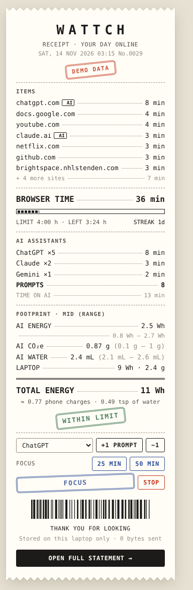
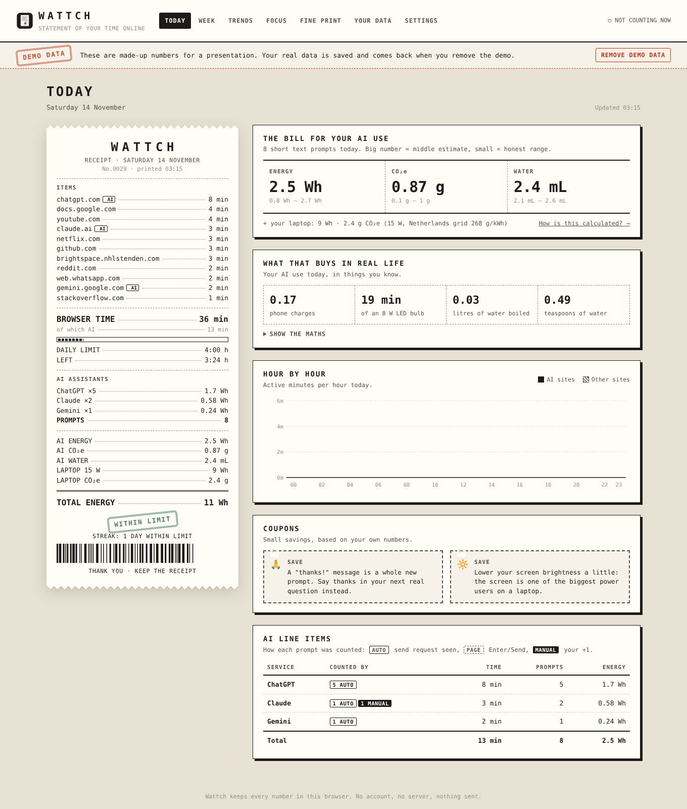

# Wattch Receipt 🧾 — what your screen time costs

**Campus Unleashed Hackathon · Team 3 · Theme: "Student Life, Fixed"**

Wattch Receipt is a Chrome extension that prints a student a **receipt for their day online**: minutes per website, minutes and prompts on AI, and what that AI use costs in **energy (Wh), carbon (g CO₂e) and water (mL)**. Everything stays on your own laptop: no account, no server, nothing is sent anywhere.

The idea: we are used to checking what things cost in euros. Wattch shows the bill for your time online in a format everyone understands: a till receipt.

| Popup: today's receipt | Dashboard: the statement |
|---|---|
|  |  |

## The interface

- **Popup = a till receipt.** Items (sites with time), subtotal browser time against your daily limit, AI assistants with prompt counts, the footprint with its range, a **TOTAL ENERGY** line, and a stamp: *WITHIN LIMIT* or *OVER LIMIT*. The barcode is drawn from your day's numbers.
- **Dashboard = a statement.** *Today* (the full receipt + "the bill" + real-life comparisons + hour-by-hour chart + tips as cut-out **coupons**), *Weekly statement* (this week vs last week, red = more, green = less), *Trends* (30 days, with the uncertainty band), *Focus tickets*, *Fine print* (the methodology, written as numbered clauses), *Your data*, *Settings*.
- **Prompt tag** on AI sites: a small paper tag on the right edge with today's prompts and footprint for that site, +1 / −1.
- Light (paper) and dark mode. Monospace type, ink + one red stamp colour; AI is printed solid, other sites hatched, so charts also work in black and white.
- **Demo mode** (Your data → Load demo data): fills 4 weeks of made-up days for a presentation, clearly stamped *DEMO DATA* everywhere. Your real data is set aside and restored when you remove it.

## Install (1 minute)

1. Download or clone this folder.
2. Open `chrome://extensions` in Chrome.
3. Switch on **Developer mode** (top right).
4. Click **Load unpacked** and select the `wattch-receipt` folder (the one with `manifest.json`).
   Load only one Wattch version at a time, otherwise both count your time and both send reminders.
5. Pin Wattch Receipt: puzzle icon in the toolbar → pin. A welcome receipt opens with two quick settings.

## What it does

| Core requirement | How Wattch does it |
|---|---|
| **1. Track browser time** | Active time per website (hostname). Counts only when a Chrome window has focus, the user is not idle (`chrome.idle`), and the tab is a normal web page. The idle-detection delay is subtracted again when you go idle, a sleeping laptop is never counted, and a tab playing sound (lecture/video) keeps counting (optional). |
| **2. Hourly reminder** | Notification after 60 minutes of *active* use (interval adjustable, 5–240 min). A real break (5 min idle) resets the clock. "Remind me in 15 min" button. |
| **3. Spot AI use** | 12 assistants recognised: ChatGPT, Gemini, Google AI Studio, NotebookLM, Claude, Copilot, Perplexity, Le Chat, DeepSeek, Grok, Meta AI, Poe, plus your own domains. Prompts counted three ways, labelled in the dashboard: **auto** (the site's "send message" network request, never its content), **page** (Enter key / Send button), **manual** (+1 / −1 buttons). |
| **4. Estimate the footprint** | Energy, CO₂e and water per prompt, always as **low / mid / high**, with the source of each number. See "About the numbers" below. |
| **5. Dashboard** | Today, This week (weekly report vs last week), Trends (30 days, with the uncertainty band), Focus sessions. |
| **6. Stay private** | Data only in `chrome.storage.local`. No network code at all. One-click export (JSON/CSV) and delete. |

**Our own spin ("Go further")**

- **Prompt cost meter** on AI sites: a small tab on the right edge with today's prompts and footprint for that site, plus +1/−1.
- **Focus sessions** (25/50/90 min) that mute reminders and record what happened in the browser.
- **Goals and streaks**: daily browsing goal (toolbar badge turns orange near it, red over it), optional daily AI prompt limit, streak counter.
- **Weekly report**: this week so far vs the same days last week.
- **Real-life comparisons with the maths shown**: phone charges, LED-bulb time, litres of water boiled, teaspoons of water.
- **Grid setting**: pick your country's electricity carbon intensity (Ember 2023) for your laptop's own electricity.
- **Your laptop's footprint too**, so students see AI in proportion to their own device.
- **Greener tips** generated from your own numbers, shown as coupons.
- **Ignore list** for sites you never want recorded (banking, health…).
- Light and dark mode.

## About the numbers

Nobody knows exactly what one prompt costs. Wattch uses the best-known public figures for one short text prompt and is open about it:

| | Energy | CO₂e | Water | Why |
|---|---|---|---|---|
| Gemini (Google AI) | 0.24 Wh | 0.03 g | 0.26 mL | Google's own published median (Aug 2025) |
| ChatGPT | 0.34 Wh | 0.13 g | 0.32 mL | OpenAI's published average (June 2025); OpenAI gives no CO₂, so 0.34 Wh × US grid 369 g/kWh |
| Others | 0.29 Wh | 0.11 g | 0.29 mL | No published figure: average of the two |
| **Range shown** | 0.10–0.34 Wh | 125–369 g/kWh | 0.26–0.32 mL | Low: Google counting only the chips. High: OpenAI's figure on the average US grid |

- Your laptop: active time × laptop watts (default 15 W) × your grid (default Netherlands, 268 g/kWh).
- These are **short text prompts**. Images, files, long answers and "deep research" cost much more, so Wattch's AI numbers are a lower bound with honest error bars.
- Every number and its source is on the dashboard page **"How it's calculated"**.

Sources: Google, *Measuring the environmental impact of delivering AI at Google scale* (arXiv 2508.15734) · Sam Altman, *The Gentle Singularity* (June 2025) · Ember, *European Electricity Review 2024* and country carbon-intensity data (2023).

## What Wattch can see (and why)

| Permission | Why | Stored |
|---|---|---|
| `tabs` | Which website is in the active tab | Hostname only (`youtube.com`), never the full URL, title or content |
| `idle` | Stop counting when you are away | Nothing |
| `alarms` | Save every 30 s, end focus sessions | Nothing |
| `notifications` | Break reminder, focus alerts | Nothing |
| `storage` | Keep your numbers on this laptop | Seconds per hostname, prompt counts, settings |
| `webRequest` + 7 AI hosts | Notice that a "send prompt" request happened on ChatGPT, Gemini, Claude, Perplexity, DeepSeek, Grok | +1 to a counter. The request body is never requested, so prompts cannot be read. Observe-only: cannot block or change requests |
| Content script on AI sites | Enter/Send detection, prompt meter badge | Nothing. It never reads the chat box or the conversation, only whether the Send button is enabled |

Check it yourself: there is no `fetch(`, `new XMLHttpRequest`, `WebSocket` or `sendBeacon` anywhere in `src/`.

## Project structure

```
manifest.json            MV3 manifest
src/background.js        service worker: time tracking, idle/focus, reminders, prompt counting, focus sessions
src/content/ai-content.js  AI sites: prompt detection (Enter/Send) + prompt meter badge
src/lib/sites.js         list of AI assistants and their "send" endpoints
src/lib/footprint.js     footprint model, sources, grid table, comparisons
src/lib/store.js         storage schema, day summaries, streaks, export/delete
src/lib/demo.js          demo mode (made-up data for presentations, real data restored after)
src/lib/dates.js, format.js, tips.js
src/popup/               the receipt popup
src/dashboard/           the statement (today, week, trends, focus, fine print, your data, settings)
src/shared/              paper design tokens (CSS), receipt helpers, small SVG charts (no libraries)
tests/                   engine tests with a fake chrome API (node tests/run-tests.mjs)
```

No build step and no dependencies: what you load is what you read.

## Tests

```
node tests/run-tests.mjs
```

22 tests run the real service worker against a fake `chrome` API and a fake clock: focus loss, idle trimming, media playing while idle, laptop sleep, ignored sites, hostname-only storage, reminders and breaks, focus sessions, prompt de-duplication between detectors, and the footprint maths. We also loaded the extension in Chrome for Testing 153 and checked tracking, the network and page detectors and the badge on mock AI pages.

## Known limits

- AI sites change their internals. If the "auto" detector stops matching a site, the page detector takes over automatically (it is only switched off for a site while auto detection has worked there in the last 2 days), and +1 always works.
- Two prompts on the same site within 5 seconds count as one.
- Time inside an extension page or `chrome://` page is not counted. Incognito is not tracked unless you allow it.
- The footprint covers AI prompts and your laptop. Ordinary websites' servers and the network are not estimated: published numbers differ too much.

## AI declaration

As required by the event rules: this project was built with **Claude (Anthropic), model Claude Opus 5.5**, used through the Claude app. Claude wrote most of the code, the tests and this README from our project brief, researched the electricity carbon-intensity figures, and tested the extension in a headless Chrome. The team reviewed, tested and is responsible for the result. The footprint figures come from the cited public sources, not from the AI.

*(Team: add your names and anything else you change here.)*
